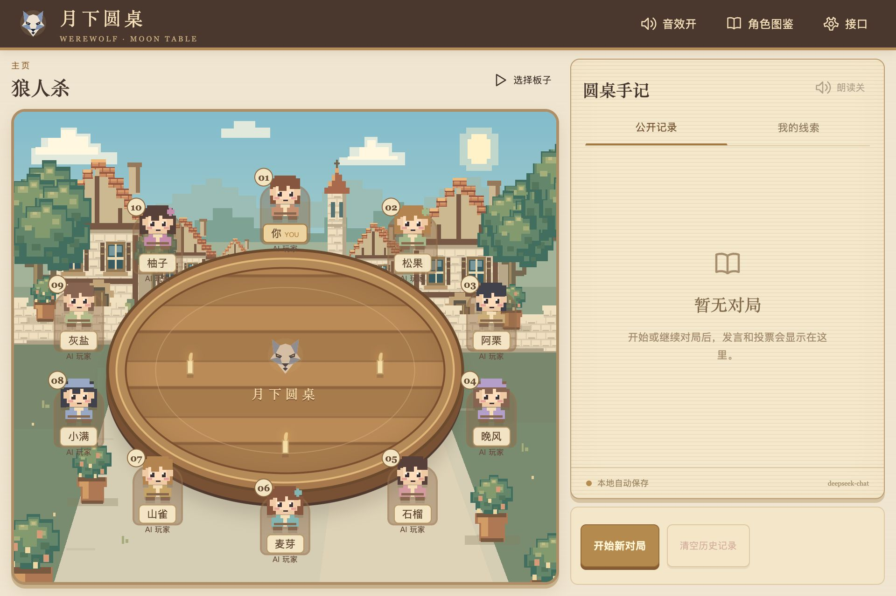
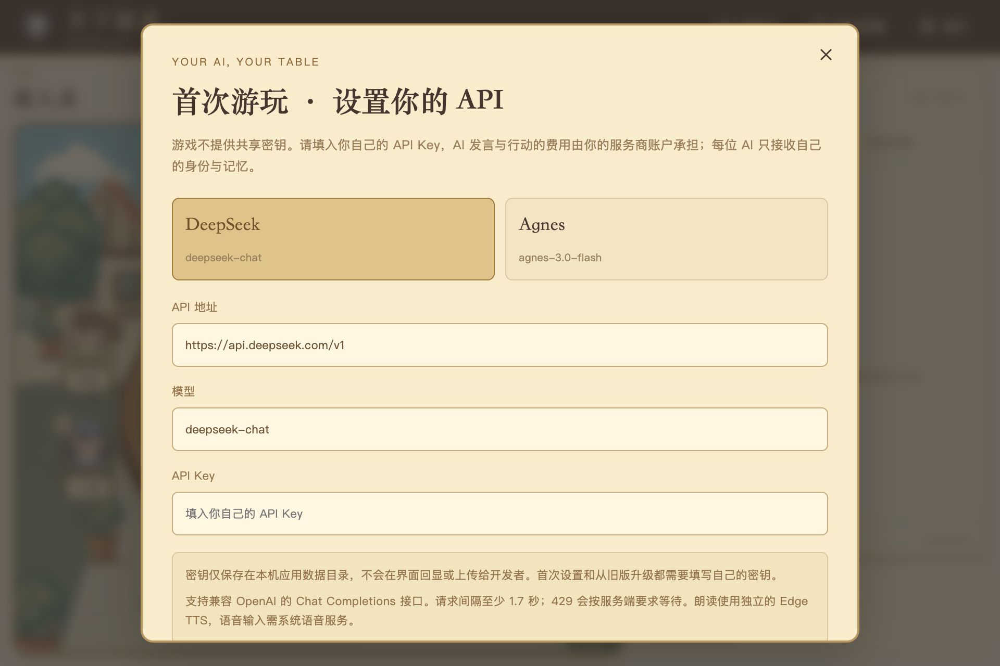
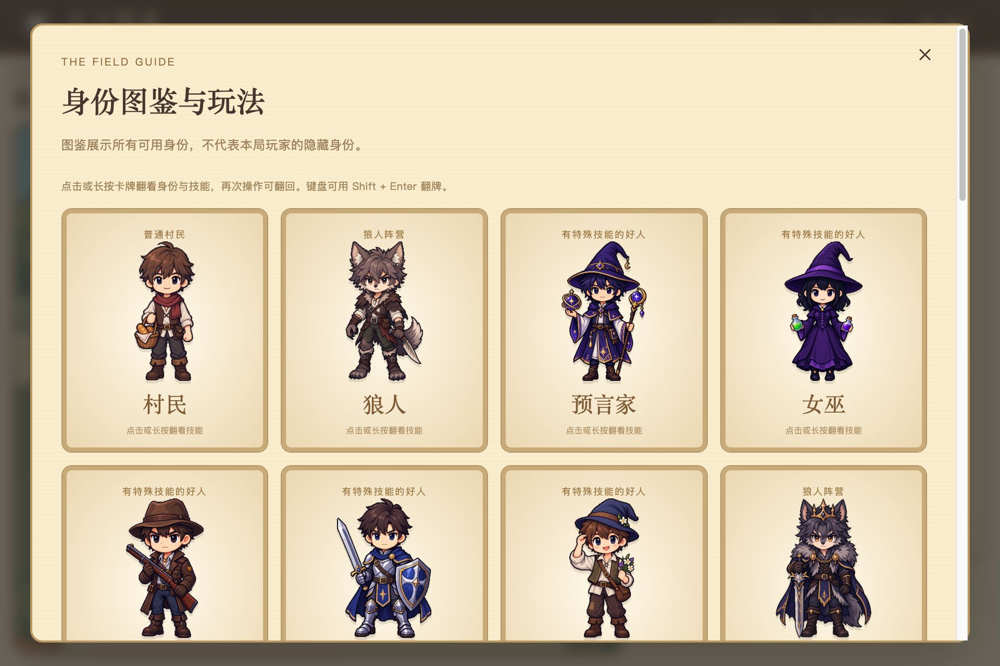
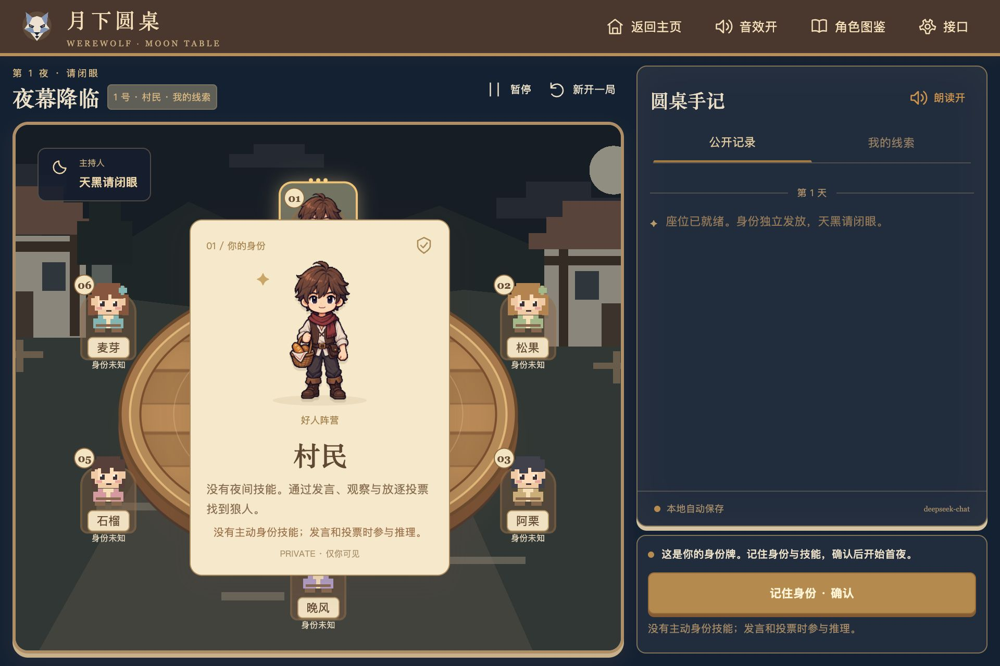
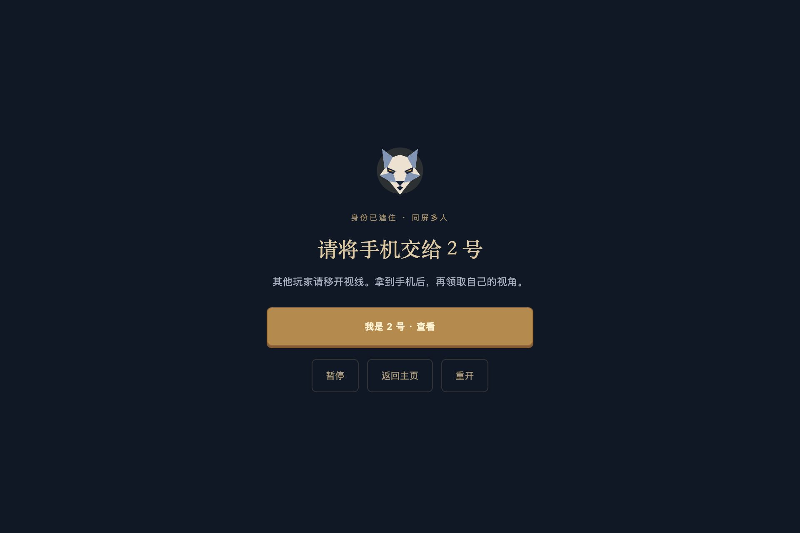

# 月下圆桌 · Moon Table

一款可在 Android 和电脑上游玩的中文狼人杀游戏。你可以独自与 AI 同桌，也可以和朋友共用一台设备，按提示遮屏交接。

**6～15 个座位 · 21 种身份 · 10 种板子 · 1～2 位真人 · 本机自动存档**



## 下载与开始

安装包放在 [Releases](https://github.com/linyx-h/moon-table/releases) 中，源码与安装包都不提供共享 API 密钥。

| 平台 | 下载文件 | 使用方式 |
| --- | --- | --- |
| Android 7.0+ | `MoonTable-Android.apk` | 安装后打开，支持 ARM64 / ARMv7 |
| macOS · Apple Silicon | `MoonTable-macOS-AppleSilicon.zip` | 解压，将 `MoonTable.app` 放入“应用程序”后打开 |
| Windows | `MoonTable-Windows.zip` | 由 Windows 构建任务生成，解压整个文件夹后打开 `MoonTable.exe` |

Mac、Windows 包内带 Python 运行时，不需要另外安装 Python 或 Node.js。Windows 原生窗口使用系统 WebView2，需要已安装 Microsoft Edge WebView2 Runtime。Mac 包尚未做 Apple 开发者公证；若系统阻止打开，可在系统“隐私与安全性”中确认来源后允许打开，无需关闭系统安全保护。

**首次打开必须设置自己的 AI 接口。** 保存后选择人数、单人或双人模式、板子，再领取身份牌进入夜晚。AI 发言与行动需要网络，也会消耗你自己的 API 额度；真人操作、裁判和存档在本机处理。

## 配置 DeepSeek / Agnes



| 服务 | API 基础地址 | 默认模型 |
| --- | --- | --- |
| DeepSeek | `https://api.deepseek.com/v1` | `deepseek-chat` |
| Agnes | `https://api.agnes-ai.cn/v1` | `agnes-3.0-flash` |
| 其他兼容服务 | 服务商的 HTTPS 基础地址 | 支持工具调用的模型名称 |

1. 从服务商账户取得自己的 API Key。例如 DeepSeek 用户可在 [DeepSeek 开放平台](https://platform.deepseek.com/) 创建密钥并确认额度。
2. 在首次设置页选择服务商，填写 Key；自定义接口还需填写基础地址与模型。
3. 点击“保存设置”。以后可用页面右上方“接口”修改；同一地址留空 Key 可保留原密钥，切换地址必须填写对应密钥。

基础地址不要填写 `/chat/completions`，程序会自动追加该路径。接口必须支持 OpenAI 风格的 Chat Completions 和 `tool_calls`。保存设置只校验格式，不等于远端凭据已验证；401 / 403 请检查密钥权限，余额或模型问题请按服务商返回的状态排查。

密钥只保存在本机 `settings.json` 中，不写入源码、安装包、对局存档或 GitHub；设置接口不会回显密钥。程序直接连接你配置的服务商，没有开发者中转服务。桌面数据目录：

- macOS：`~/Library/Application Support/MoonTable`
- Windows：`%LOCALAPPDATA%\MoonTable`
- Android：应用私有数据目录；卸载通常会删除设置与存档。

桌面配置文件采用当前用户读写权限保存，不是系统钥匙串加密存储；请不要把该目录连同源码分享。1.17 公开版不继承旧版内置凭据，旧用户也需填写自己的 Key。

## 游戏画面与玩法







截图来自实际运行界面，仅展示配置与领牌阶段，不代表一次完整 AI 对局。

- **单人对局**：除你之外的座位由 AI 补齐。各 AI 独立接收本人身份、可见技能结果和公共发言；不会直接读到裁判的全部身份表。
- **双人同屏**：两位真人从 1、2 号入座。依提示传递设备，确认接过后再显示私有身份；看完遮屏，避免朋友看到你的线索。它不是网络联机模式。
- **身份技能**：预言家查验、女巫用药、守卫保护、猎人开枪，以及狼美人、摄梦人、骑士、石像鬼等特殊玩法，规则由本机裁判执行。
- **白天讨论**：逐席发言、焦点回应、限时讨论与独立投票；多人可当面讨论后记录发言与投票。达到规则规定的阵营胜利条件后揭晓身份。
- **板子与图鉴**：经典板子适合入门，复杂版可选特殊板子和部分神职；点击或长按身份牌查看技能。随机预览确认后固定本局配牌。
- **退出与续局**：暂停、返回主页或普通接口异常会保存行动断点。AI 接口异常后可修正设置再继续，不会用虚构台词代替失败请求。
- **朗读与语音输入**：主持提示音随包提供；动态 AI 朗读使用独立的 Edge TTS，可跳过或关闭。安卓语音输入需要麦克风权限和系统识别服务，桌面语音识别取决于系统 WebView，文字输入始终可用。
- **出局后**：可观战，或在支持条件下盲选接管尚未翻牌的 AI 角色；接管属于练习玩法，不会重置该角色技能。

## 源码与开发

| 文件 / 目录 | 职责 |
| --- | --- |
| `game.py` | Python 裁判、技能结算、AI 请求、私有视角和 SQLite 存档 |
| `catalog.py` / `role_skills.py` | 身份、板子、规则与各角色策略指南 |
| `android_server.py` | 仅监听本机的 HTTP / SSE / 音频传输，共享两端 |
| `web/src/` / `web/public/` | React 界面、角色美术和主持音频 |
| `android/` | Android WebView、系统语音输入、Chaquopy 和 Gradle |
| `desktop.py` | Mac / Windows 原生窗口外壳，复用同一游戏服务和界面 |
| `tests/test_api_settings.py` | 无真实 API 调用的公开版配置与单／双人回归 |
| `.github/workflows/desktop.yml` | 手动构建 Windows / Mac 桌面包 |

### 本地电脑运行

需要 Node.js 20.19+ 与 Python 3.10+，推荐 Python 3.11。

```bash
python3 -m venv .venv
# macOS / Linux
source .venv/bin/activate
# Windows PowerShell 使用：.venv\Scripts\Activate.ps1
python -m pip install -r requirements-desktop.txt
npm ci
npm run build
python desktop.py
```

也可运行 `python desktop.py --browser` 使用系统浏览器；终端 Ctrl+C 停止服务。服务仅绑定 `127.0.0.1`，没有远程托管或多人服务器。指定独立试玩目录可用 `--data-dir 路径`。

### 构建电脑版

在目标操作系统执行：

```bash
python build_desktop.py --output dist
```

Windows 可在仓库 Actions 中手动运行 **Build desktop**。`release_tag` 留空时下载 Actions 构建产物；填入已有 Release 标签则上传到该 Release。Windows 二进制必须由 Windows 构建，Mac 构建不能证明 Windows 原生行为已验证。

### 构建安卓版

需要 JDK 17、Android SDK 35 / build-tools 35.0.0，以及 Python 3.10：

```bash
export JAVA_HOME="/你的/JDK17/Contents/Home"
export ANDROID_HOME="/你的/Android/sdk"
export MOON_BUILD_PYTHON="/你的/python3.10"
bash build_android.sh
```

签名材料不放入仓库。默认脚本生成本地签名；维护同一签名时配置 `MOON_KEYSTORE` 和 `MOON_SIGN_PASSWORD`。不同签名的安装包不能直接覆盖旧版，请先备份需要的内容再卸载旧版；重新安装会要求设置自己的 Key。脚本输出 APK 到源码目录的上一级。

### 检查与验证范围

```bash
python -m unittest discover -s tests -v
npm run build
```

1.17 的回归检查覆盖：无内置 Key、首次配置、设置不回显密钥、旧凭据隔离、切换服务商、非法配置、各固定板子、单／双人模式、遮屏交接与恢复，以及 DeepSeek / Agnes 工具调用的请求协议。协议测试使用虚构密钥和 HTTP 测试响应，**未消耗真实 API 额度，也不能证明远端模型的推理质量**。

AI 可能做出错误推理或战术选择。浏览器验证与编译检查不等于 Android / Windows 真机验收；设备语音识别、后台恢复和服务商限额仍需要在实际使用环境确认。
